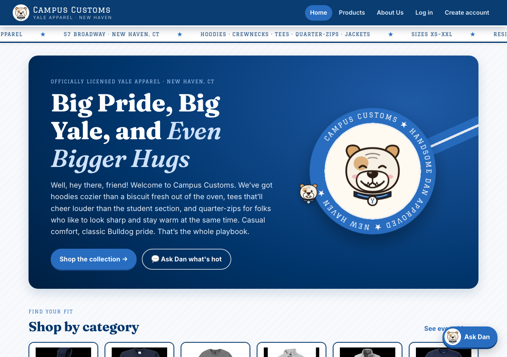
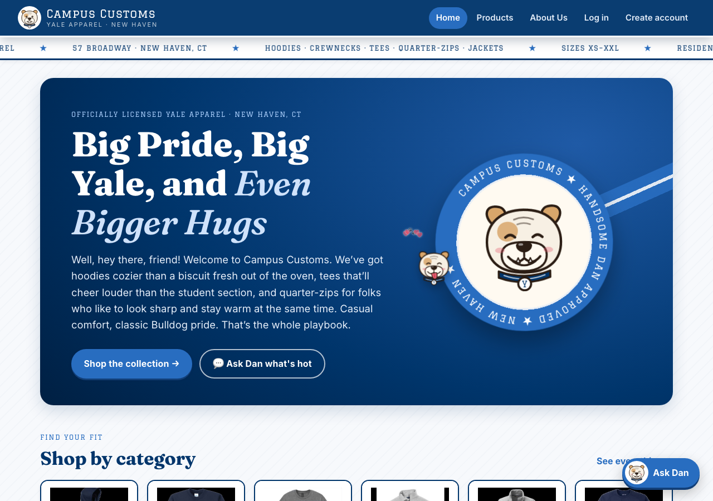
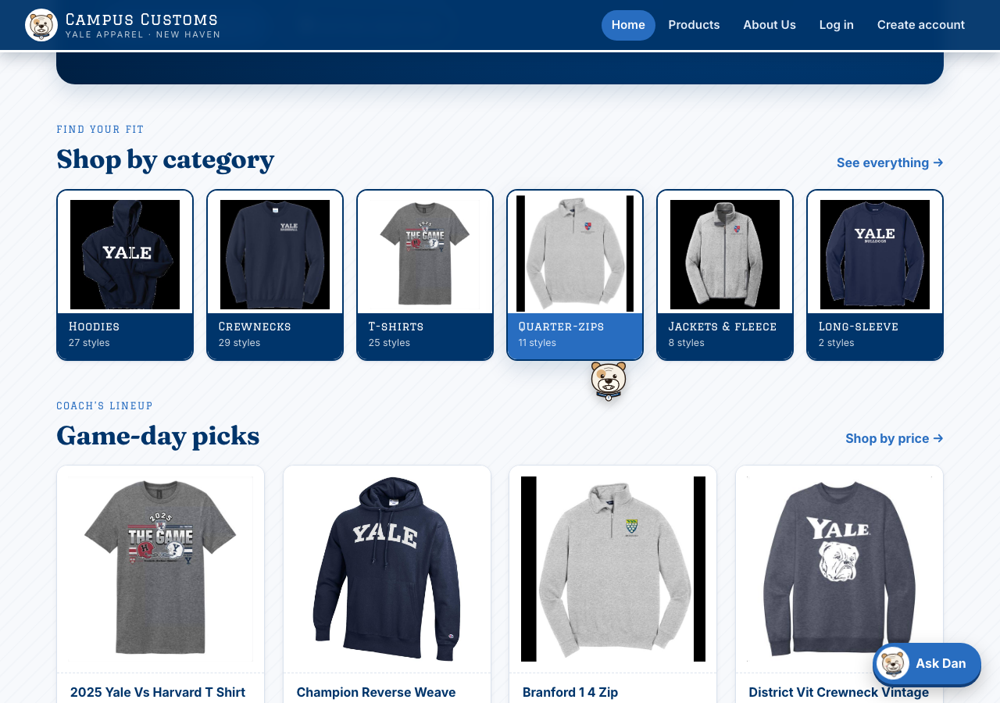
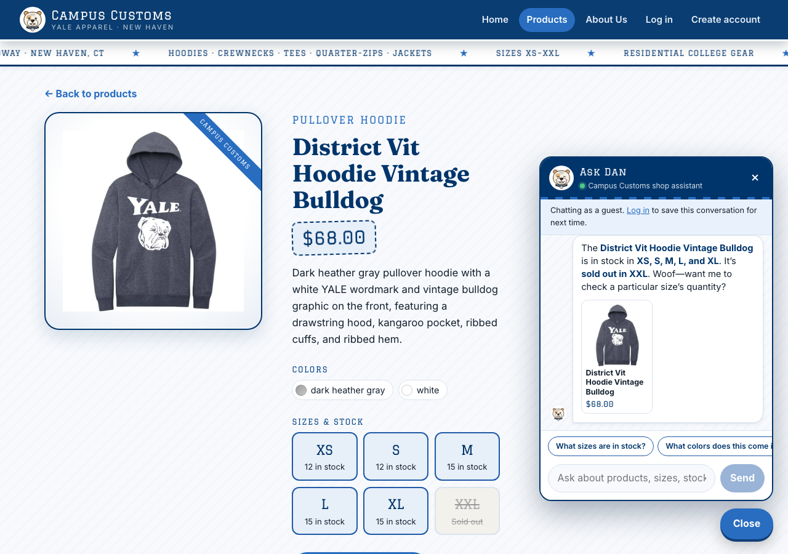
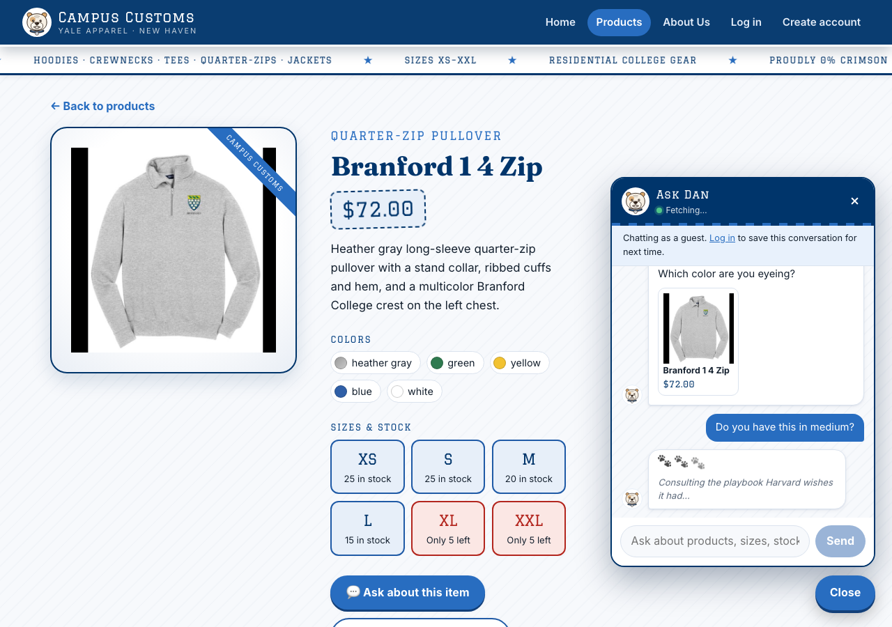

# Campus Customs: Storefront Design (Problem 10)

The goal: make the site feel like walking into a campus shop, not using a demo app, so shoppers stay longer, trust the store, and reach a product they can buy. It's dressed in **Yale Blue and white**, with a little friendly Harvard rivalry.

## Handsome Dan, the mascot who follows you

**What:**
- **Drawn in code:** Handsome Dan, Yale's bulldog, is an SVG drawing ([`HandsomeDan.tsx`](../frontend/src/components/HandsomeDan.tsx)), no image files. He has a tan eye patch, wrinkled brow, underbite teeth, and a Yale-blue sweater collar with a white "Y" tag.
- **Three moods:** neutral, smile, and lick. His eyes blink on their own.
- **Cursor buddy** ([`DanCursor.tsx`](../frontend/src/components/DanCursor.tsx)):
  - He trails the mouse with easing and sits just beside the pointer, so he never covers what you're clicking.
  - He leans into fast moves and turns to face the direction you're going.
  - **Every click:** he alternates a tongue-out **lick** and a big **grin**, and 5 hearts and paw prints pop out where you clicked. Every 5th click he barks, rotating "Woof!", "Boola Boola!", and "Beat Harvard!"
  - **Idle 6 seconds:** he does a full **spin**.
- **Elsewhere:** Dan is the nav logo, the hero badge (on a rotating "CAMPUS CUSTOMS ★ HANDSOME DAN APPROVED ★ NEW HAVEN" ring), the chat button and avatar, the Products banner, the empty states, and the 404 page.

**Why it helps people stay and buy:**
- A playful, on-brand mascot is the thing visitors remember and screenshot, and it makes a small shop feel like a place with personality.
- Each click getting a tiny reward makes browsing more fun, so people click into more products.

**Kept respectful:**
- He only runs with a real mouse. Touch screens and people with "reduce motion" turned on don't get him.
- He never intercepts clicks (`pointer-events: none`).
- He moves the DOM directly on each animation frame, with no re-renders, so the page stays smooth.
- The footer has a **"Handsome Dan follows my cursor"** switch, which is remembered.

## Brand system: type, color, and texture

**What:**
- **Graduate**, a collegiate varsity block font, for labels, prices, sizes, and the logo.
- **Fraunces**, a warm editorial serif with italics, for headlines.
- **Inter** for body text.
- All fonts are self-hosted (`@fontsource`), so there are no outside font requests.
- **Color:** **Yale Blue** (`#00356b`) for the nav, headlines, prices, and sizes; Yale's brighter accent blue (`#286dc0`) for buttons and highlights; white and a cool paper tone (`#f7f9fc`) with a faint diagonal weave behind everything. Red appears only as a *warning* (low stock, errors), so it always means "act now".
- **Campus details:** a white **ticker** with Yale-blue lettering under the nav (licensed apparel · 57 Broadway · categories · sizes XS–XXL · "Proudly 0% crimson" · "Ask Dan"), blue-and-white varsity-stripe trims, a jacket sash behind the hero badge, and pennant-tab value cards.

**Why:** varsity type in Yale's own blue and white signals "official Yale store" within a second, which builds trust before anyone reads a word. The ticker repeats real selling points (licensed, local, every size) without taking up page space. It only states facts, with no invented shipping or sale claims.

## Clearer hierarchy and product presentation

**What:**
- **Home is now a shopping funnel:**
  - The hero has a big headline and two clear calls to action: **Shop the collection** and **Ask Dan what's hot**.
  - **Shop by category** tiles show a real product photo and a live style count, and jump straight to the filtered Products page (`/products?category=hoodie`).
  - **Game-day picks** show four featured items.
  - Then the brand values.
- **Product cards:** a dashed "stitched" divider, a varsity price, a lift and photo zoom on hover, and a **View details** pill that slides up.
- **Product page:**
  - The photo sits on a cream "display stage" with a **CAMPUS CUSTOMS** corner ribbon. The stage stays in view while you scroll on desktop.
  - The price is a tilted, dashed **price tag**.
  - Colors show as real **swatches**.
  - Sizes look like **jersey numbers**: Yale blue when in stock, red when low, crossed out when sold out.

**Why:**
- Category tiles turn "I want a hoodie" into one click, the shortest path to a product page.
- The price tag and jersey sizes make the two buying questions, "how much?" and "is my size there?", the easiest things to see.
- Hover feedback tells shoppers every card is clickable.

## Motion that guides, not distracts

**What:**
- Pages fade in when you navigate.
- Cards and tiles rise in a quick stagger, capped so long grids never wait.
- Buttons have a springy press with a "3D" bottom edge.
- The hero badge floats, and the logo Dan tilts on hover.
- The ticker pauses when you hover over it.
- `prefers-reduced-motion` turns all of it off.

**Why:** motion tells shoppers where to look next and that something happened, which makes the store feel quick and alive. Each animation is short (under 0.5s) so it never slows anyone down.

## Chat that feels like talking to Dan

**What:**
- **The button:** the chat button is Dan's face plus **Ask Dan**. He peeks side to side every few seconds.
- **The panel:**
  - It springs open from the corner.
  - Its header shows Dan, a green **online** dot, and a varsity-stripe trim.
  - Replies come in white bubbles with Dan's avatar, and the shopper's messages are Yale-blue bubbles.
  - While the agent works, three bouncing **🐾 paw prints** stand in for the usual "…", along with a rotating quip, e.g. *"Fetching faster than Harvard leaves The Game at halftime…"*, *"Checking the stockroom. No crimson back there, promise…"*, *"Consulting the playbook Harvard wishes it had…"*
  - When an answer lands, the header Dan does a happy **lick**, then a grin.
- **The agent:** the prompt now says it's shown as Dan, so it can answer to the name lightly (an occasional "woof") while staying the shop assistant. It may also rib Harvard in small doses when it fits ("perfect for watching us beat Harvard at The Game"), teasing the school but never people.

**Why:** a named, friendly character makes people more willing to ask, and asking is how they find an in-stock item in their size. The paw-print typing indicator covers the few seconds the agent takes to think, so the wait feels intentional rather than broken.

## Friendly Harvard rivalry

**Where:**
- The chat's fetching quips.
- Dan's "Beat Harvard!" bark.
- "Proudly 0% crimson" in the ticker.
- The 404 page ("Maybe it transferred to Harvard").
- The empty search ("And no, we don't carry anything crimson").
- The agent, lightly, when a shopper brings it up.

**Why:** the rivalry is part of being a Yale fan, and an inside joke makes shoppers feel like insiders. The jokes show up in the moments that would otherwise be dull (waiting, dead ends, a 404) and never get in the way of an answer.

## Small fixes found while styling

- **Quieter console for guests:** `GET /api/auth/me` now returns `null` (200) for guests instead of a 401. Every guest page load had shown red "Unauthorized" errors in the browser console.
- **Badge ring:** the gradient and the text circle were sized differently, which hid the text. They're now on the same scale.
- **Hero sash:** it's anchored to Dan's badge so it never crosses the paragraph.
