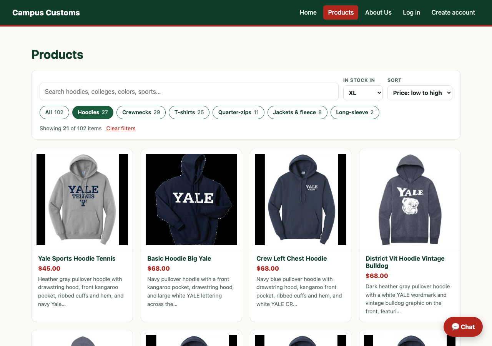
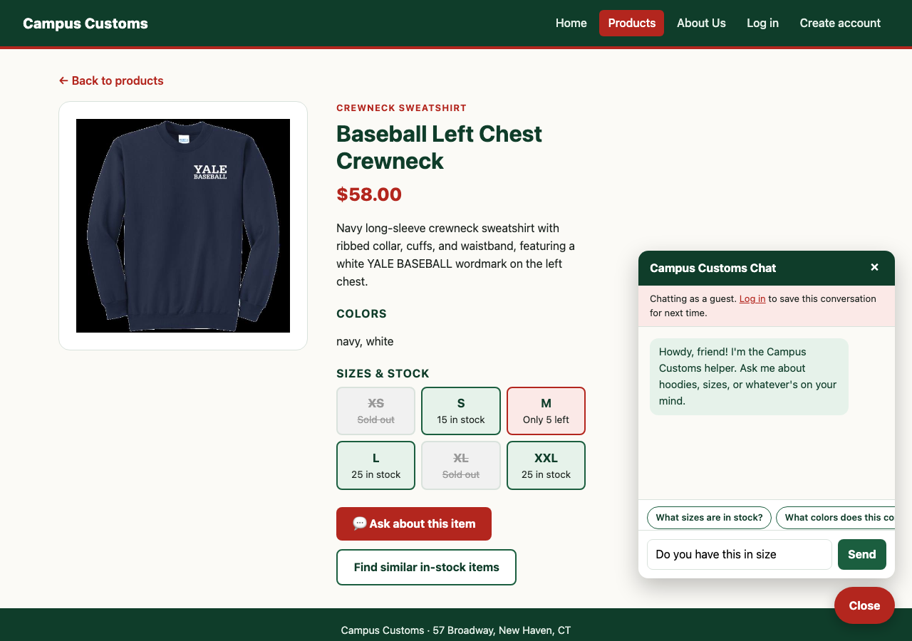
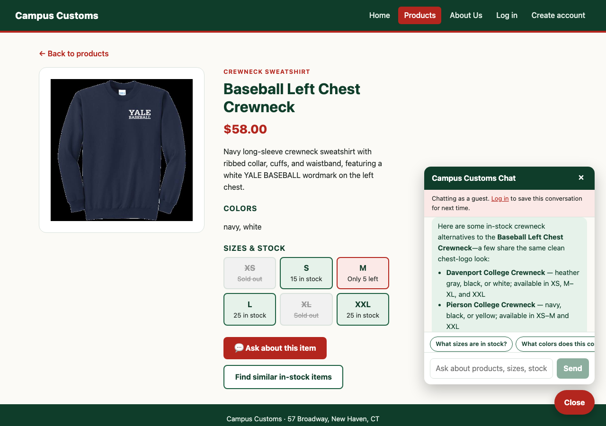

# Campus Customs: Usability Improvements (Problem 9)

Four improvements: two on the website, two in the agent and backend. Each one is live in the running app (frontend `http://127.0.0.1:5175`, backend `uvicorn main:app --reload --port 8000` from `backend/`).

| # | Area | Improvement | Where to see it |
|---|---|---|---|
| 1 | Front end | Search, filter, and sort on the Products page | `/products`: toolbar above the grid |
| 2 | Front end | Chat quick questions and "Ask about this item" | Chat panel chips; buttons on every product page |
| 3 | Agent / backend | `find_similar_products` tool: in-stock alternatives | "Find similar in-stock items" button, or ask about a sold-out size |
| 4 | Agent / backend | Price fact-check guard | `python test_price_guard.py`; `Price guard:` lines in the uvicorn log |

---

## 1. Front end: search, filter, and sort on the Products page

**What I added**
- **Search box:** matches every word against a product's name, type, description, colors, and tags, so "bulldog", "Branford", or "navy crest" all work.
- **Category chips with live counts:** All 102 · Hoodies 27 · Crewnecks 29 · T-shirts 25 · Quarter-zips 11 · Jackets & fleece 8 · Long-sleeve 2. The backend maps the database's 22 messy `garment_type` spellings into these categories (`tools.garment_category`), so the counts are right.
- **"In stock in" size filter:** shows only items available in the shopper's size. `GET /api/products` now includes each product's `sizes_in_stock`, so this needs no extra requests.
- **Sort:** name, price low → high, or price high → low.
- **Results summary:** "Showing 21 of 102 items", with a **Clear filters** link.
- **Shareable filters:** the filters live in the URL (e.g. `/products?category=hoodie&size=XL&sort=price-asc`), so a filtered view can be bookmarked or shared, and it survives Back.
- **Sold-out badge:** any card with no stock in any size gets one.
- **Empty state:** when nothing matches, an **Ask the shop assistant** button hands the search to the chat.

**Why it helps**
- **Shoppers:** before this, finding a hoodie in your size meant scrolling all 102 cards and opening each one to check stock. Now it's two clicks: Hoodies → XL gives 21 items, all available, cheapest first ($45).
- **The business:** the size filter means fewer shoppers fall for an item only to find it sold out, which is a common reason to leave. Shareable URLs let staff and shoppers send "all our quarter-zips" as one link. The empty state turns a dead end into a conversation instead of a bounce.

**Verified in the running app:**
- Hoodies = 27, Hoodies + XL = 21, and cheapest = $45.00, all matching SQL on `campus_customs.db`.
- "bulldog" = 10 results, matching SQL.
- "pink zebra" shows the empty state, and its button opened the chat, which honestly said there was no match.

---

## 2. Front end: chat quick questions and "Ask about this item"

**What I added**
- **Quick-question chips** above the chat input, which change with the page:
  - Product page: *What sizes are in stock?* · *What colors does this come in?* · *Show me similar items*
  - Products page: *Show me hoodies* · *What's under $40?* · *Anything for Branford College?*
  - Elsewhere: *What's good for game day?* · *Show me hoodies* · *Gift ideas for a Yale parent*

  One tap sends the question.
- **Two buttons on every product page:**
  - **💬 Ask about this item** opens the chat with "Do you have this in size " typed and the cursor ready for their size.
  - **Find similar in-stock items** asks the agent for alternatives right away (see improvement 3).
- **`askChat()` helper:** a small event-based function in `frontend/src/api.ts` that lets any page open the chat and ask something. The Products empty state uses it too.

**Why it helps**
- **Shoppers:** many don't know what a shop chatbot can do, and typing on a phone is a chore. Chips show what to ask and answer it in one tap.
- **Product pages:** "this" already works there because of page context (Problem 8), so the chips and buttons pair the right question with the right product automatically.
- **The business:** the assistant is the shop's most helpful feature, but it only helps people who use it. Visible, relevant prompts make it far more likely a shopper engages and gets to an in-stock item.

**Verified in the running app:**
- Chips change between the Products page and a product page.
- "Ask about this item" opened the panel with the prefilled text.
- "Find similar in-stock items" sent the question and got cards back. That answer is shown in improvement 3.

---

## 3. Agent: `find_similar_products`, in-stock alternatives

**What I added**
- **A new agent tool,** `find_similar_products(product, size=None)` in [`backend/tools.py`](../backend/tools.py). It ranks every other product by:
  - Same garment category: +5
  - Each shared color: +1.5
  - Each shared motif from the tags (e.g. *bulldog, vintage, crest, chest logo*): +1. Generic words like "Yale" or "sweatshirt" don't count.
  - Closeness in price.
- **Stock filtering:** it only returns items **in stock**, and in the shopper's size when one is given.
- **Typed results:** `SimilarProducts` returns the matches, each with a `why_similar` reason, e.g. "also a hoodie; shares white; similar: bulldog, graphic, vintage."
- **Prompt rule:** when a size is sold out or the shopper wants "something like this", call the tool with their size, suggest the top 2–3 using the reasons, and show them as cards.

**Why it helps**
- **Shoppers:** before, a sold-out size was a dead end, or the model had to improvise alternatives with several searches and stock checks. Now one tool call returns alternatives that are truly in stock in their size, with a reason each fits.
- **The business:** a sold-out size is a lost sale unless the shopper is offered something close. This turns "sorry, sold out" into "here are three you can buy now."
- **Speed:** it's one model round trip instead of several, which also makes the reply faster.

**Verified:**
- The live "Find similar in-stock items" request made a single `find_similar_products` call and suggested Davenport, Pierson, and Super Heavyweight crewnecks. Their sizes and colors match `inventory` and `catalogue` exactly.
- For the vintage-bulldog hoodie, the top match is the vintage *sailor* bulldog hoodie.
- For the Baseball crewneck in XL (which is sold out), all six suggestions are in stock in XL.

---

## 4. Agent: price fact-check guard

**What I added**
- **A PydanticAI output validator** (`prices_must_be_grounded` in [`backend/agent.py`](../backend/agent.py)). It runs on every reply before the shopper sees it.
- **What counts as allowed:** it collects every price that appeared in **this turn's** tool results and the server's page-context note, plus any dollar amount the shopper typed (budgets like "under $50"). Simple multiples are allowed too, e.g. "two for $116".
- **What happens on a mismatch:** if the reply quotes any other dollar amount, the reply is rejected. The model gets `ModelRetry` feedback ("Your reply quotes $65, but no tool result or page context in this turn has that price… look it up") and must fix the answer. Each catch is logged as a `Price guard:` warning.
- **A test,** [`backend/test_price_guard.py`](../backend/test_price_guard.py). It uses a scripted model with no API calls that answers "$65" from an old chat, and proves the guard rejects it and the final reply says the real $72.

**Why it helps**
- **Wrong prices are a real failure mode.** Logged-in customers now get their old chats loaded as history (Problem 8), so the model can see prices quoted days ago. If a price changes, a model working from memory would repeat the old one, and a wrong price can cost a shop money, goodwill, or a complaint.
- **Code checks every reply.** The prompt already says "prices from tools only," and the guard checks it on every reply. A slip is caught and fixed before the shopper sees it.

**Verified:**
- `python test_price_guard.py` → `PASS: stale $65 was rejected by the guard; final reply: The Branford 1/4 Zip is $72.`
- The unit checks allow real prices, totals, and the shopper's own budget, and flag the wrong $65 and an unknown $1,000.
- In three live runs with the stale "$65" in history, the real model looked up the price and said $72 each time. The prompt is doing its job, and the guard is a backstop for when it doesn't.

---

## Also measured: reasoning effort (not adopted)

To make the agent faster and cheaper, I added per-turn usage logging and a benchmark, then tested the model's reasoning-effort setting.
- **Usage log:** each turn logs a line like `Usage: 4.57s, 2 model calls, 1 tools, 6884 in (5755 cached) / 302 out (58 reasoning) tokens`.
- **Benchmark:** [`backend/bench_agent.py`](../backend/bench_agent.py) asks 6 questions graded against the database. It bypasses Portkey's response cache so every run reaches the model.

| Reasoning effort | Avg seconds | Median seconds | Avg tokens / turn | Avg reasoning tokens | Input served from prompt cache | Correct |
|---|---|---|---|---|---|---|
| `default` | 4.41 | 4.47 | 8,612 | 58 | 95% | 12/12 |
| `none` | 10.15 | 4.99 | 8,862 | 0 | 95% | 12/12 |

- **Conclusion:** reasoning is only about 60 tokens a turn, and 95% of input tokens are already served from the provider's prompt cache. Turning reasoning off saved nothing and caused 35-second outliers, so the agent keeps the default (`AGENT_REASONING_EFFORT` can still override it).
- **Deployment limit:** on this Azure deployment, tool calling only accepts effort `none` or no setting.
- **Portkey cache:** repeated identical questions came back in about 0.3s from Portkey's response cache.
- **Speed already gained:** improvements 3 and 4 make answers quicker and more accurate, with fewer round trips for alternatives and fewer wrong prices.
- **Still useful:** the benchmark doubles as an accuracy test suite: `python bench_agent.py --efforts default --repeats 1`.
